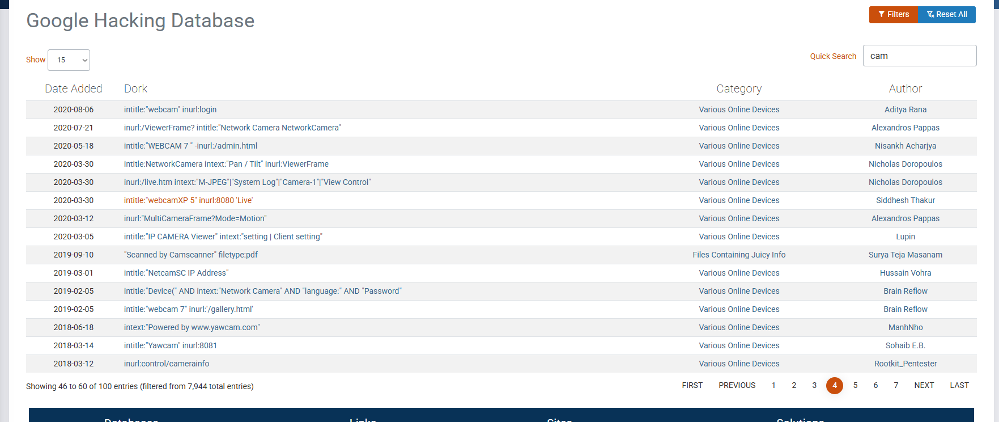

# 🛡️ NETWORKWALKS-MALEKAROUA-B084-WK2-GHDB-OSINT

**Building practical OSINT reconnaissance, Google Hacking Database (GHDB) search dorks, and passive discovery capabilities**

---

## 📌 Project Overview

This project documents hands-on practical exercises completed during Week 2 of the NetworkWalks internship. The focus of this module is **Passive Open Source Intelligence (OSINT)** using the **Google Hacking Database (GHDB)** to identify publicly exposed assets, misconfigured web-connected devices, and open document directories without initiating unauthorized active scans.

---

## 🎯 Objectives

The main goals of these practical labs are:

* Master advanced Google search operators and dorks for targeted passive reconnaissance.
* Identify unauthenticated, publicly exposed live camera feeds and analyze their associated risks.
* Recognize server-level configuration errors that expose file directories (`Index of /`) and documents.
* Apply professional data sanitization protocols to protect privacy and uphold ethical disclosure standards in public code repositories.

---

## 🛡️ Scope & Authorization

> ⚠️ **Disclaimer:** All reconnaissance activities were conducted strictly for educational purposes as part of the official NetworkWalks cybersecurity curriculum. All data collection relied exclusively on passive, publicly accessible search engine indexing (GHDB). No unauthorized access, active scanning, or exploitation was performed against any target system. All target IP addresses and paths have been sanitized.

---

## ⚙️ Environment & Tooling Summary

| Component | Specification / Setting |
| --- | --- |
| **Primary Environment** | Web Browser / Search Engine / Kali Linux |
| **Reconnaissance Technique** | Google Hacking Database (GHDB) Passive Dorking |
| **Primary Targets** | Exposed Web Cameras & Open Directories (`mathematics pdf`) |
| **Sanitization Standard** | Octet Masking (`82.xx.xx.xxx`, `192.xxx.x.x`, `xx.xx.xxx.xxx`) |

---

## 📂 Project Structure & Modules

* **Task 1: Exposed Live Camera Feeds**
* Applied specific camera-identifying search dorks (`inurl:view/index.shtml`, etc.).
* Verified public camera interfaces globally while recording manufacturer types and states.
* Applied octet masking to ensure ethical documentation.

* **Task 2: Open Directory Footprinting (`mathematics pdf`)**
* Utilized directory indexing dorks (`intitle:"index.of"`) to discover misconfigured servers.
* Documented target paths exposing unauthenticated academic documents.
* Analyzed how the exact same misconfiguration (`Options +Indexes`) exposes sensitive backups or credentials in production environments.

---

## 📊 Lab Documentation & Findings

### Task 1: Exposed Live Camera Feeds

**Objective:** Document 5 publicly accessible network camera feeds identified via GHDB dorks.

| Target # | IP Address / URL | Location / Organization | Camera Model / Interface | Verification Status |
| --- | --- | --- | --- | --- |
| **01** | `82.xxx.xx.xxx:8081` | France  | Yawcam / Web Interface | Verified (Live) |
| **02** | `95.xxx.xxx.xxx:8080/multi.html` | Italy  | WebcamXP / WEBCAM 7 | Verified (Live) |
| **03** | `100.xxx.xx.xxx/view/index.shtml` | USA  | AXIS 211 Network Camera | Verified (Live) |
| **04** | `192.xxx.xxx.xxx` | Finland | Vivotek / Web Interface | Verified (Live) |
| **05** | `220.xxx.xxx.xxx` | Japan | Panasonic HD / Web Interface | Verified (Live) |

#### Security Impact:

IoT devices deployed without strong authentication expose live video streams to the public internet. In an operational security context, these misconfigurations provide unauthorized viewers with physical surveillance capabilities or potential pivot points into internal subnets.

---

### Task 2: Open Directory Footprinting (`mathematics pdf`)

**Objective:** Identify 5 web servers with active directory indexing exposing unauthenticated documents.

| Target # | Base Domain | Exposed Directory Path | Sample Document Exposed | Security Impact |
| --- | --- | --- | --- | --- |
| **01** | `ochicken.net` | `/library/Mathematics/` | `math-hyperref.pdf` | Unrestricted directory listing |
| **02** | `theswissbay.ch` | `/pdf/Books/Mathematics/` | `MIT6_Math4CompSci.pdf` | Public file system indexing |
| **03** | `unm.edu` | `/~megrad/Math/` | `Mathematics-2017.pdf` | Unrestricted academic path |
| **04** | `lira.epac.to` | `/DOCS-TECH/Math/` | `Essential Engineering Math.pdf` | Exposed server directory index |
| **05** | `math.mcgill.ca` | `/[Sanitized Path]/` | `[Sample PDF]` | Exposed folder indexing |

#### Security Impact:

Although educational documents were targeted for safe analysis, server misconfigurations of this type (`Options +Indexes`) frequently lead to accidental disclosure of database dumps (`.sql`), source code, configuration files containing credentials, or administrative logs.

---

## 🖼️ Evidences Collected

### 1. GHDB Camera Feed Reconnaissance

### 2. Open Directory Indexing (`Index of /`)

---

## 💡 What I Learned

1. **The Power of Passive OSINT:** Advanced search operators can unearth deeply hidden administrative interfaces and misconfigured files without sending a single active packet to a target network.
2. **Configuration Over Code:** Many critical leaks do not stem from software bugs, but from simple server misconfigurations like leaving directory indexing enabled (`Options +Indexes`).
3. **Professional Reporting & Privacy:** Protecting privacy through proper octet redaction is a vital skill for maintaining clean, compliant, and ethical cybersecurity portfolios on GitHub.

---

## 🔗 Resources & References

* **NetworkWalks Cybersecurity Curriculum (Batch B084)**
* **Google Hacking Database (GHDB) / Exploit-DB:** [https://www.exploit-db.com/google-hacking-database](https://www.exploit-db.com/google-hacking-database)

---

## 👤 Author

**Malek Aroua**

*Computer Networks Graduate | Cybersecurity Specialist*

---
